<picture>
  <source media="(prefers-color-scheme: dark)" srcset="./assets/header-dark.svg">
  
</picture>

I build AI products end to end, from design to production. Most of them run
on Claude Code. An agent reads a written procedure,
calls small Python tools in order, and produces a finished deliverable: a
report, a newsletter, a video.

The part I care about most is what happens when the model gets something wrong.

## What happens to a bad claim

<picture>
  <source media="(prefers-color-scheme: dark)" srcset="./assets/pipeline-dark.svg">
  
</picture>

My competitor-analysis workflow will not render a report if any claim has no
source, any link is dead, placeholder text is left in, or a forbidden name
appears. Its first real run covered 9 companies, with about 190 sources and
more than 400 cited claims.

## Projects

| | |
|---|---|
| [**claude_vibe_coding_projects**](https://github.com/elkushi/claude_vibe_coding_projects) | Agentic workflows built with Claude Code. Parallel research agents, a JSON Schema contract between steps, a validator as the gate, branded PDF output. |
| [**ai-video-image-generator**](https://github.com/elkushi/ai-video-image-generator) | My own app: brand kit + topic in, short videos and image posts out. Claude agents write, Python tools render, QA checks the result. FastAPI + React web app, Docker, CI. |
| [**system-audit**](https://github.com/elkushi/system-audit) | Bash tool that audits a Linux server: SUID files, open ports, SSH config, cron jobs, sensitive file permissions, failed logins. Writes a timestamped report. |

## Security basics

I build AI apps with basic security from the start:

- AI agents get an allowlist of tools, never open shell access.
- Uploads and file paths are checked, so nobody can read files outside the app.
- Servers run HTTPS, key-only SSH and logins with hashed passwords.
- Keys stay in `.env`, and every repo is scanned for secrets before it goes public.
- I wrote [system-audit](https://github.com/elkushi/system-audit), a Bash tool that checks a Linux server for common misconfigurations.

## Background

- **Day job:** B2B messaging (SMS, WhatsApp, Viber). I designed and built the
  company website, [ritorica.com](https://ritorica.com), and took it from the
  first commit to production on a Linux server: Django CMS, PostgreSQL, a Gemini
  chatbot and automated deploys. I also write technical specs and
  documentation, and talk to client engineers and partners at industry events.
- **Before that:** Arabic AI quality at Yandex, reviewing and correcting
  answers from the Alice voice assistant.
- **Education:** MSc Software Engineering, BSc Avionics Engineering, Moscow
  Aviation Institute.
- **Languages:** Arabic (native), English and Russian (C1).

**Tools:** Python · Claude Code · JSON Schema · Django · FastAPI · React · TypeScript · PostgreSQL · Docker · Linux · Bash · Git

<picture>
  <source media="(prefers-color-scheme: dark)" srcset="https://raw.githubusercontent.com/elkushi/elkushi/output/snake-dark.svg">
  
</picture>

**Contact:** [moustafa.elkoushy7@gmail.com](mailto:moustafa.elkoushy7@gmail.com)
